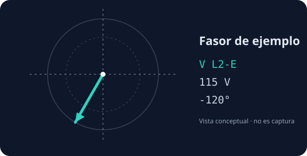

<div align="center">
  

  **Edita, inspecciona y verifica archivos OCC desde Windows, sin depender de un editor propietario.**

  [](https://github.com/TehDudeOne/OccEdit/actions/workflows/windows-build.yml)
  [](LICENSE)
  
  
  

  [Características](#-qué-hace) · [Compilar](#-compilación) · [Seguridad](#-seguridad-y-limitaciones) · [Code signing policy](CODE_SIGNING_POLICY.md) · [Colaborar](#-contribuir)
</div>

---

> [!IMPORTANT]
> **Proyecto comunitario en desarrollo (v0.7).** La compilación en Windows, la compatibilidad con diferentes tipos de OCC y la firma de código todavía requieren validación adicional. No utilices copias modificadas como evidencia oficial de ensayos sin comprobarlas primero en OMICRON Test Universe.

## ⚡ Qué hace

**OCCEdit** es una aplicación nativa de escritorio para Windows que analiza contenedores `.occ` y permite modificar **campos de texto y parámetros compatibles** de módulos QuickCMC, además de visualizar tablas e información interna.

| Función | Descripción |
|:--|:--|
| 📂 **Explorar OCC** | Abre contenedores estructurados OLE/CFB y muestra sus flujos internos. |
| 📝 **Editar QuickCMC** | Permite editar títulos, comentarios y campos compatibles de tensión/corriente. |
| 🗂️ **Vista de informe** | Presenta texto y tablas; permite editar celdas cuyos registros de texto estén reconocidos. |
| 🧭 **Fasores** | Reconstruye una vista preliminar de vectores de tensión y corriente a partir de magnitudes y ángulos de las tablas compatibles. |
| 💾 **Guardar como copia** | Conserva el archivo original y verifica la estructura y los contenidos reconocidos tras escribir. |
| 🧪 **Pruebas** | Incluye un caso de regresión para extracción de fasores con celdas agrupadas. |

### Vista fasorial: corrección de la v7

La revisión v7 corrige la extracción de filas cuya primera columna está vacía por agrupación visual. En este ejemplo de **datos ilustrativos**, el fasor `V L2-E = 115 V ∠ −120°` debe dibujarse hacia abajo e izquierda, aunque la celda «Directo» solamente aparezca en la primera fila.

<div align="center">
  
  <br />
  <sub>Esquema explicativo, no captura de la aplicación ni validación de una medición real.</sub>
</div>

## 🚀 Compilación

**Requisitos**: Windows 10/11 x64, Visual Studio 2022 o Build Tools con *Desktop development with C++* y Windows SDK.

```powershell
# Desde la carpeta raíz del repositorio, en PowerShell:
.\Compilar.bat
```

Archivo de salida: `dist\OCCEdit_v7_x64.exe`.

Para compilar sin pausa al terminar (por ejemplo, en CI):

```powershell
.\Compilar.bat /quiet
```

**GitHub Actions:** el workflow [Windows x64 build and phasor tests](.github/workflows/windows-build.yml) compila el proyecto y ejecuta las pruebas de fasores en `windows-2022`. Los ejecutables producidos por ese workflow son **de prueba y no están firmados**. Su publicación en Actions no implica compatibilidad certificada con Test Universe ni aprobación de Smart App Control.

### Ejecutar pruebas de fasores localmente

```powershell
cl /nologo /utf-8 /std:c++20 /EHsc /W4 tests\test_phasor_model.cpp /Fe:dist\test_phasor_model.exe
.\dist\test_phasor_model.exe
```

Los comandos `cl` requieren una consola de desarrollador de Visual Studio configurada. La prueba también es compatible con compiladores C++20 como GCC o Clang.

## 🛡️ Seguridad y limitaciones

- **No sobrescribe el OCC de origen:** utiliza el flujo «Guardar como copia» y vuelve a leer la salida para comparar los datos reconocidos.
- **La verificación no equivale a certificar todo el archivo:** podrían existir estructuras propietarias que OCCEdit aún no interprete.
- **El gráfico es una reconstrucción:** no es el objeto fasorial original de OMICRON y puede diferir de él.
- **No subas informes reales al repositorio:** pueden contener resultados de ensayo, datos de equipos, clientes o instalaciones.
- **Windows Smart App Control:** las compilaciones actuales no tienen una firma de código confiable. No se recomienda desactivar protecciones del sistema para ejecutarlas.
- **Funcionamiento local:** la aplicación no incorpora funciones previstas de telemetría ni carga automática de archivos; cualquier nueva contribución debe respetar esta característica.

Si descubres una vulnerabilidad, consulta [SECURITY.md](SECURITY.md). Para conocer los responsables, el proceso de firma y el estado de la solicitud a SignPath Foundation, consulta [Code signing policy](CODE_SIGNING_POLICY.md).

## 🧱 Estructura del proyecto

```text
OccEdit/
├── native_editor.cpp         # Interfaz Win32 y control del documento
├── quick_results.cpp/.h     # Datos y campos de QuickCMC
├── report_text.cpp/.h       # Texto de informes
├── report_preview.h         # Tablas y presentación del informe
├── phasor_model.h           # Extracción de datos fasoriales
├── gzip_codec.cpp/.h        # Compresión GZIP
├── sevenzip_codec.cpp/.h    # Datos 7z / LZMA2
├── lzma_sdk/                # SDK original 7-Zip (con su licencia)
├── tests/                   # Pruebas reproducibles
├── Compilar.bat             # Compilación nativa en Windows
└── .github/workflows/       # CI para Windows x64
```

## 🤝 Contribuir

¡Las mejoras son bienvenidas! Lee [CONTRIBUTING.md](CONTRIBUTING.md) antes de abrir un *pull request*. Algunas tareas prioritarias:

- Ampliar pruebas de lectura y escritura sobre datos sintéticos.
- Añadir pruebas de integración de diagramas fasoriales en la interfaz Win32.
- Mejorar robustez frente a archivos truncados o malformados.
- Validar formatos OCC adicionales sin incorporar informes privados.
- Preparar el proceso de firma de código mediante SignPath Foundation, sujeto a su aprobación.

## 📜 Licencia y créditos

Distribuido bajo [licencia MIT](LICENSE). Incluye [LZMA SDK / 7-Zip](THIRD_PARTY_NOTICES.md), que conserva su aviso original. El desarrollo es comunitario e independiente.

**OMEGA / OMICRON / QuickCMC / Test Universe:** las marcas mencionadas pertenecen a sus respectivos titulares. **OCCEdit no es un producto oficial ni está afiliado, patrocinado o respaldado por OMICRON.**
